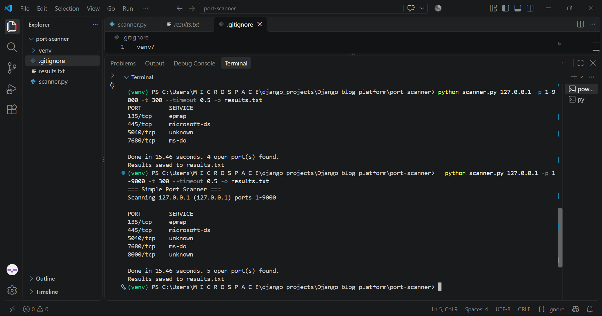

# Port Scanner

A fast, multithreaded TCP port scanner written in Python. It checks which ports are open on a target, shows the common service name for each, and can save a report to a text file.

> **Legal notice:** Only scan machines you own or have explicit permission to test. Unauthorized scanning may be illegal.



## Features

- Scan a single port or a range (`80` or `1-1000`)
- Multithreaded for speed (default 100 threads, adjustable)
- Adjustable timeout per port
- Service name lookup for open ports
- Save results to a text report
- No external libraries needed, only the Python standard library

## Requirements

- Python 3.8 or newer

## Usage

```
python scanner.py <host> [-p PORTS] [-t THREADS] [--timeout SECONDS] [-o FILE]
```

| Option | Description | Default |
|--------|-------------|---------|
| `host` | Target IP or hostname | required |
| `-p`, `--ports` | Port or range, e.g. `80` or `1-1000` | `1-1024` |
| `-t`, `--threads` | Number of threads | `100` |
| `--timeout` | Seconds to wait per port | `1.0` |
| `-o`, `--output` | Save results to a file | none |

### Examples

```
python scanner.py 127.0.0.1
python scanner.py 127.0.0.1 -p 1-9000 -t 300 --timeout 0.5
python scanner.py 127.0.0.1 -p 1-1000 -o results.txt
```

### Sample output

```
PORT        SERVICE
135/tcp     epmap
445/tcp     microsoft-ds
8000/tcp    unknown

Done in 15.46 seconds. 3 open port(s) found.
```

## How it works

The scanner tries a TCP connection to each port using Python's `socket` module. If the connection succeeds, the port is open. A `ThreadPoolExecutor` runs many checks at the same time, and `socket.getservbyport` finds the service name.

## Ideas for improvement

- Banner grabbing to identify service versions
- UDP scanning
- JSON or CSV output
- A progress bar

## Disclaimer

This project is for learning and authorized security testing only.